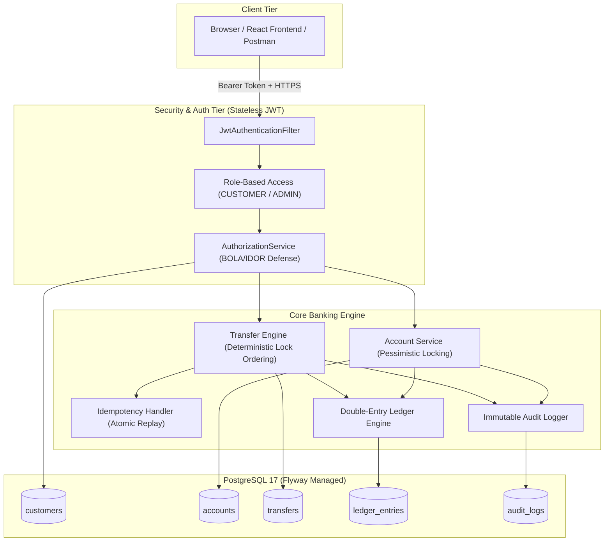
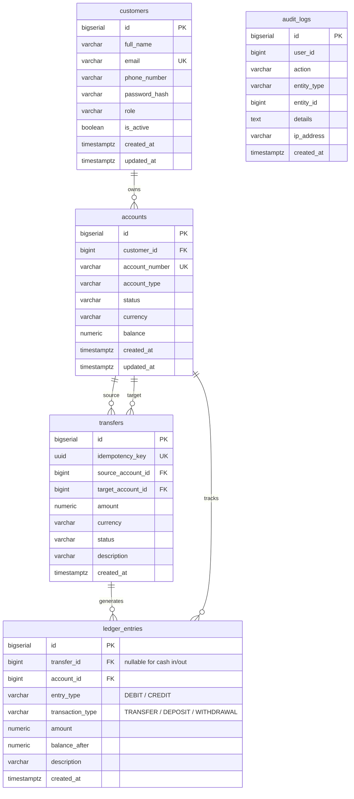

# LedgerCore — Institutional-Grade Fintech Banking & Transaction Engine

[](https://www.oracle.com/java/technologies/downloads/#java21)
[](https://spring.io/projects/spring-boot)
[](https://www.postgresql.org/)
[](https://flywaydb.org/)
[](https://spring.io/projects/spring-security)

> **Disclaimer:** *LedgerCore is a simulated digital banking engine designed for portfolio demonstration, architecture evaluation, and financial transaction pattern modeling. It does not connect to real financial rails or handle real customer funds.*

---

## 🌟 Executive Summary

**LedgerCore** is a modular digital banking engine built with **Java 21**, **Spring Boot 3**, and **PostgreSQL**. Unlike typical CRUD applications, LedgerCore is engineered from the ground up to solve the hard problems of fintech backends:
- **Zero Double-Spending:** Strict concurrency control with PostgreSQL pessimistic write locking (`SELECT ... FOR UPDATE`).
- **Deadlock-Free Transfers:** Deterministic lock acquisition ordering on account entities (`Math.min` then `Math.max`).
- **Network Retry Safety:** Idempotent transfer execution using client-supplied UUIDs with atomic race-condition handling.
- **Double-Entry Bookkeeping:** 100% of all balance movements (transfers, deposits, withdrawals) generate immutable debits and credits with point-in-time balance snapshots (`balance_after`).
- **Object-Level Authorization (BOLA/IDOR Defense):** Robust customer ownership verification preventing horizontal privilege escalation.
- **Regulatory Audit Trail:** Append-only event store capturing customer registrations, account status transitions, and fund movements.

---

## 🏗️ System Architecture



---

## 🔑 Key Engineering & Financial Features

### 1. Concurrency Control & Deadlock Elimination
When accounts transact concurrently (e.g., Account A transfers to Account B while Account B transfers to Account A), arbitrary locking creates fatal database deadlocks. LedgerCore eliminates this problem:
- Locks accounts in **strictly ascending numerical order of Account ID** (`Math.min(id1, id2)` followed by `Math.max(id1, id2)`).
- Executes `SELECT ... FOR UPDATE` via Spring Data JPA's `@Lock(LockModeType.PESSIMISTIC_WRITE)`.

### 2. Idempotent Transfer Execution
Network drops and client retries are common in real payments.
- Clients attach an `Idempotency-Key: <UUID>` header.
- If a duplicate request arrives, LedgerCore returns the cached original transfer output without executing a second debit.
- Concurrent races on the same idempotency key are safely caught via `DataIntegrityViolationException` recovery.

### 3. Double-Entry Accounting Ledger
Balances are never modified without an immutable ledger entry.
- **Transfers:** Creates a balanced pair: `DEBIT` on source account, `CREDIT` on destination account.
- **Deposits:** Creates an immutable `CREDIT` entry recording `balance_after`.
- **Withdrawals:** Creates an immutable `DEBIT` entry recording `balance_after`.
- **Reconciliation Engine:** Endpoint `GET /api/ledger/reconcile` computes:
  $$\sum \text{Debits} \equiv \sum \text{Credits}$$

### 4. Broken Object-Level Authorization (BOLA/IDOR) Defense
Authentication alone is insufficient for banking. `AuthorizationService` inspects the authenticated principal on every request:
- A customer cannot query another customer's balance or account details.
- A customer cannot initiate transfers originating from an account they do not own.
- Administrative endpoints (account freezing, reconciliation, audit log queries) are restricted strictly to `ROLE_ADMIN`.

---

## 📊 Database Schema (Flyway Versioned)



---

## 🛠️ Tech Stack

| Component | Technology | Rationale |
|---|---|---|
| **Language** | Java 21 (LTS) | Virtual threads readiness, pattern matching, record types |
| **Framework** | Spring Boot 3.5.6 | Enterprise standard for financial microservices |
| **Security** | Spring Security + JJWT 0.12.6 | Stateless JWT authentication, BCrypt password hashing |
| **Persistence** | Spring Data JPA / Hibernate 6 | ORM, pessimistic locking, transactional boundaries |
| **Database** | PostgreSQL 17 | ACID compliance, transactional DDL, row-level locking |
| **Schema Migrations** | Flyway 11 | Version-controlled, reproducible database schema |
| **Connection Pool** | HikariCP | High-performance, low-latency connection pooling |
| **Testing** | JUnit 5, AssertJ, Spring Test | Unit tests and multithreaded concurrency suites |

---

## 🚀 Quick Start Guide

### Prerequisites
- **JDK 21** installed (`java -version`)
- **PostgreSQL 15+** running locally on port `5432`
- **Maven 3.9+** (or use bundled `./mvnw`)

### 1. Database Setup
Create the PostgreSQL database and user:
```sql
CREATE DATABASE ledgercore_db;
CREATE USER ledgercore_app WITH PASSWORD 'secure_password_123';
GRANT ALL PRIVILEGES ON DATABASE ledgercore_db TO ledgercore_app;
```

### 2. Configure Environment Variables
Set the following environment variables (or modify `application.properties`):
```bash
# Windows PowerShell
$env:LEDGERCORE_DB_PASSWORD="secure_password_123"
$env:LEDGERCORE_JWT_SECRET="5367566B59703373367639792F423F4528482B4D6251655468576D5A71347437"

# Linux / macOS
export LEDGERCORE_DB_PASSWORD="secure_password_123"
export LEDGERCORE_JWT_SECRET="5367566B59703373367639792F423F4528482B4D6251655468576D5A71347437"
```

### 3. Build & Run
```bash
./mvnw clean compile
./mvnw spring-boot:run
```
Flyway will automatically apply all versioned migrations (`V1` through `V6`). On startup, the default administrator account is seeded:
- **Admin Email:** `admin@ledgercore.com`
- **Admin Password:** `Admin@123` *(override with `LEDGERCORE_ADMIN_PASSWORD`)*

---

## 📖 REST API Reference

All protected endpoints require the header:
`Authorization: Bearer <JWT_TOKEN>`

### 1. Authentication (`/api/auth`)
| Method | Endpoint | Access | Description |
|---|---|---|---|
| `POST` | `/api/auth/register` | Public | Register new customer; returns profile + signed JWT |
| `POST` | `/api/auth/login` | Public | Authenticate credentials; returns signed JWT |

### 2. Accounts (`/api/accounts`)
| Method | Endpoint | Access | Description |
|---|---|---|---|
| `POST` | `/api/accounts` | Customer / Admin | Open bank account (`SAVINGS` or `CURRENT`) |
| `GET` | `/api/accounts/{id}` | Owner / Admin | Retrieve account details and balance |
| `GET` | `/api/accounts/number/{accountNumber}` | Owner / Admin | Retrieve account by account number |
| `GET` | `/api/accounts/customer/{customerId}` | Owner / Admin | Retrieve all accounts for customer |
| `POST` | `/api/accounts/{id}/deposit` | Owner / Admin | Deposit funds (records `CREDIT` in ledger) |
| `POST` | `/api/accounts/{id}/withdraw` | Owner / Admin | Withdraw funds (records `DEBIT` in ledger) |
| `PATCH` | `/api/accounts/{id}/status` | **Admin Only** | Update status (`ACTIVE`, `FROZEN`, `CLOSED`) |

### 3. Fund Transfers (`/api/transfers`)
| Method | Endpoint | Access | Header | Description |
|---|---|---|---|---|
| `POST` | `/api/transfers` | Owner / Admin | `Idempotency-Key: <UUID>` | Atomic transfer between accounts |
| `GET` | `/api/transfers/{id}` | Participant / Admin | — | Retrieve transfer details |
| `GET` | `/api/transfers/account/{accountId}` | Owner / Admin | — | Transfer history for an account |
| `GET` | `/api/transfers/idempotency/{key}` | Participant / Admin | — | Look up transfer by idempotency key |

### 4. Financial Ledger (`/api/ledger`)
| Method | Endpoint | Access | Description |
|---|---|---|---|
| `GET` | `/api/ledger/account/{accountId}` | Owner / Admin | Full double-entry transaction statement |
| `GET` | `/api/ledger/reconcile` | **Admin Only** | System-wide balance check ($\sum Dr = \sum Cr$) |

### 5. Compliance & Auditing (`/api/audit-logs`)
| Method | Endpoint | Access | Description |
|---|---|---|---|
| `GET` | `/api/audit-logs/user/{userId}` | **Admin Only** | Audit trail for specific user |
| `GET` | `/api/audit-logs/entity/{entityType}/{entityId}` | **Admin Only** | Audit trail for specific entity |

---

## 🧪 Testing & Verification

LedgerCore includes automated multithreaded concurrency tests verifying transactional safety:

```bash
./mvnw test
```

### Multithreaded Concurrency & Idempotency Test
Located at `src/test/java/com/ledgercore/transfer/TransferConcurrencyAndIdempotencyTest.java`:
- Spawns **10 concurrent threads** using `ExecutorService` and `CountDownLatch` firing at the exact same millisecond with identical idempotency keys.
- **Assertions:**
  1. All 10 threads return HTTP 200/201 with the identical transfer ID.
  2. Source account balance is debited **exactly once** (zero double-spending).
  3. Destination account is credited **exactly once**.
  4. Exactly **2 ledger entries** (1 Debit, 1 Credit) are written to PostgreSQL.

---

## 📂 Project Structure

```
d:\LedgerCore\src\main\java\com\ledgercore\
├── LedgerCoreApplication.java
│
├── account\               # Account domain (entity, repository, service, controller, DTOs)
├── audit\                 # Audit logging domain (immutable event store)
├── auth\                  # Authentication endpoints (login, register DTOs)
├── common\exception\      # GlobalExceptionHandler and custom financial exceptions
├── config\                # System data initializers & runtime configurations
├── customer\              # Customer domain (entity, repository, service, controller, DTOs)
├── ledger\                # Double-entry ledger (debits, credits, reconciliation)
├── security\              # Spring Security filter chain, JWT service, BOLA authorization
└── transfer\              # Transfer engine (pessimistic locking, idempotency protection)
```

---

## 📜 License

Distributed under the MIT License. See `LICENSE` for more information.
